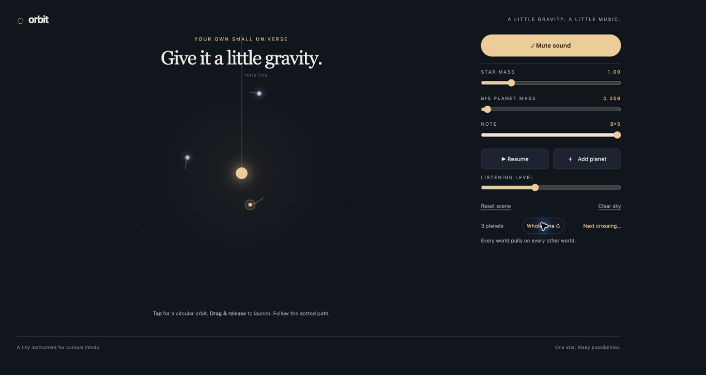

# Orbit

A small browser instrument where gravity makes the rhythm. Add tiny worlds, shape their paths and hear harmonious notes as they cross the moving star's note line.

**[Play Orbit](https://syymza.github.io/musical-planets/)** · [Report an issue](https://github.com/syymza/musical-planets/issues) · [Contributing](CONTRIBUTING.md)



## Play

- Tap empty space for a circular starting orbit, or drag and release to launch along the dotted prediction.
- Set **Note lines** from 1 to 12. The rays spread evenly around the moving star; each crossing can play a note. One upward ray is the default.
- Add up to **32 planets**. Select a planet to change its mass or its note. Adjust star mass to change the system's motion.
- Press **Start listening** to enable sound. Startup is silent; note-line crossings make the music. The same button then mutes or unmutes.
- Cycle the scale button through major pentatonic, minor pentatonic and whole tone. The six-position Note slider retunes the selected planet.
- Use **Pause**, **Reset scene** or **Clear sky** to start another experiment.

With a primary pointer that supports fine control and hover, at any viewport width, Tab to the sky and use **[ / ]** for previous/next planet. Selection wraps in creation order. The shortcut works only inside the sky, never in a slider, input or editable field, and is disabled on mobile/coarse-pointer layouts. Off-screen bodies keep simulating and remain selectable through small edge arrows, including in the keyboard cycle.

The camera gently fits the scene around the star, with a zoom-out cap of twice the original view. A distant escape gets an edge arrow instead of shrinking the entire scene indefinitely. Select an arrow to edit that planet; it does not teleport or relaunch it. Framing freezes during aiming, and resizing cancels the current aim safely. Reset restores the starting view; Clear eases inward.

Tab to a planet, use arrow keys to nudge its velocity, or Delete to remove it. Enter or Space opens its mass control. Reduced motion suppresses trails and pulses; **Pause** stops the simulation.

Sound is synthesized locally with Web Audio. There are no accounts, dependencies, analytics, runtime AI or API calls. Browser audio needs a user gesture; note adjustment can also enable a preview. Actual output depends on the device, volume and audio routing. Physical iPhone playback has not been verified.

## Run locally

From the repository root, with Python 3 installed:

```sh
python3 -m http.server 8000 --bind 127.0.0.1
```

Open [localhost:8000](http://localhost:8000). Stop the server with Ctrl+C. Any static web server works; no build or package installation is required.

## Run checks

Python 3.9+ and Node.js 24 run the same checks as CI:

```sh
python3 scripts/check-site.py
node --check app.js
node --check camera.js
node --check audio.js
node --check physics.js
node tests/run-node.cjs
```

The existing suite covers gravity and merger invariants, prediction, timing, musical mapping and app handlers using a small DOM fixture. The Node runner and macOS runner execute the same suite. On macOS, Python can also run it through built-in JavaScriptCore:

```sh
python3 tests/run-macos.py
```

For an optional local physics/prediction benchmark (not a CI timing threshold), run `node tests/performance.cjs`.

The fixture does not render the page or play audio. For interface changes, also check desktop and phone layouts, pointer/touch launches, keyboard controls, repeated selections without page jumps, pause/reset/clear, sound initialization and mute, reduced motion and the browser console. Distinguish offline audio measurements from listening on a physical speaker.

## Source guide

| File | Responsibility |
| --- | --- |
| `index.html`, `style.css` | Interface and responsive layout |
| `app.js` | Input, scene state, drawing and simulation loop |
| `camera.js` | Bounded framing, projection and off-screen marker placement |
| `physics.js` | Gravity, integration, collisions and prediction |
| `audio.js` | Scales, note synthesis, impact sounds and voice limits |
| `tests/` | Existing simulation and interface checks plus runners |
| `scripts/check-site.py` | Offline local-reference checks |

[Model and audio notes](docs/model-and-audio.md) explain the simulation's assumptions and sound limits. Orbit is a toy, not a precision astronomy model or a full music workstation.

## Contributing and publication

**All changes require a PR; do not push directly to `main`.** See [CONTRIBUTING.md](CONTRIBUTING.md). GitHub Pages publishes `main` from `/ (root)` at the play link above. Validation runs on PRs and `main` without deployment permissions. Merging requires maintainer approval and can publish changes.

No project license has been selected; contact the owner before assuming reuse permission.
